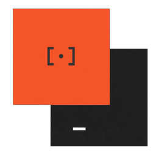
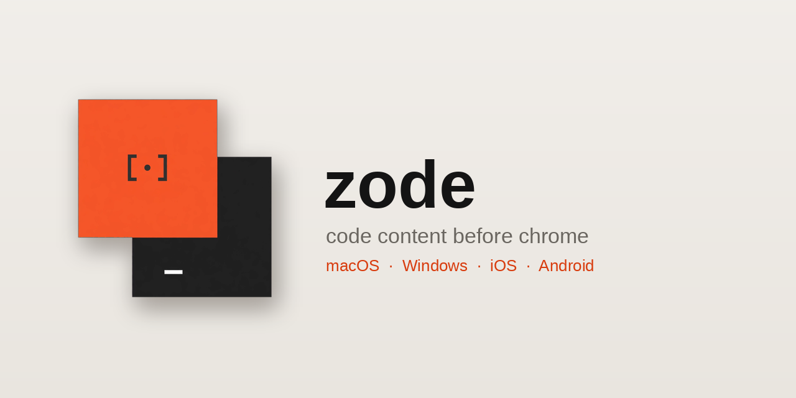

<div align="center">



# zode

**Code content before chrome — native shells, a Pre-Win8 Metro desktop workbench, and Zune HD mobile clients.**

One product, five surfaces, one contract.

</div>

---

## Download

Every push to `main` cuts a release with real binaries. These links always point at the newest
one:

| Platform | File | What it is |
|---|---|---|
| **macOS** | [zode-macos-universal.dmg](https://github.com/maceip/zode/releases/latest/download/zode-macos-0.1.0-universal.dmg) | The native macOS shell in a disk image |
| **Windows** | [zode-windows-x64.msi](https://github.com/maceip/zode/releases/latest/download/zode-windows-0.1.0-x64.msi) | Per-user installer, no admin rights |
| **Windows** | [zode-windows-x64.zip](https://github.com/maceip/zode/releases/latest/download/zode-windows-0.1.0-x64.zip) | The portable build — unzip it and run `Zode.Shell.exe` |
| **Android** | [zode-android-debug.apk](https://github.com/maceip/zode/releases/latest/download/zode-android-0.1.0-debug.apk) | Debug build — install with "unknown sources" |
| **iOS** | — | Builds from source; see [mobile/ios](mobile/ios/README.md) |

[All releases →](https://github.com/maceip/zode/releases)

> The macOS disk image is currently **signed ad-hoc, not notarised**, so a *downloaded* copy gets
> macOS's "downloaded from the internet" warning and may be moved to the Trash. A copy you build
> yourself on the same Mac is never quarantined and opens with no prompt. See
> [docs/RELEASING.md](docs/RELEASING.md).

---

## What this is

Zode is an **agentic coding workbench** built on the visual language of the original Zune desktop
client (2006–2011), Zune HD (2009), and pre-Windows 8 Metro: flat hard-edged surfaces, a near-black
ink or warm-paper canvas, giant light display typography (`-0.04em` tracking), uppercase tracked
labels, and fast spring-driven reveal motion.

It is an **experimental departure from the three-column IDE and chat-sidebar layout that rules
today**. Where conventional agentic coding tools bury your workspace inside nested split panes,
accordion trees, and scrolling chat logs, Zode treats the entire workspace as a **four-level
semantic zoom hierarchy (Z0–Z3)**:

- **Z0 (`HUB`)** — A three-column spatial panorama (**Spotlight**, **Quicklaunch**, and **Live
  Status**) with polymorphic telemetry tiles: sparkline velocity bars, unified diff hunk micro-bars,
  CI pipeline step blocks, and active agent lane matrices.
- **Z1 (`COLLECTION` / `REVIEW` / `AGENTS` / `TERMINAL` / `SETTINGS`)** — Editorial workspaces with
  two-tier pivots, file posters, side-by-side hunk triage, parallel agent lanes, and real PTY /
  bridge execution.
- **Z2 (`CONVERSATION`)** — An editorial **Conversation Turn Matrix** where every agent turn is a
  structured row with tool badges, collapsible reasoning traces, inline diff previews, and live
  token telemetry.
- **Z3 (`FILE DETAIL`)** — Deep code inspection with inline blame/diff gutters and zero surrounding
  chrome.

On mobile (`< 768px` or inside the Android shell), Zode renders a native **Zune HD** experience: a
horizontal Panorama with **18 px peek** of the next section, a vertical **28 px Quickplay gutter**
with a `rotate(-90deg)` section header, a thumb-reachable **Transport Pill**, and an **Alphabet Jump
Grid** overlay (`# A B C D ... Z`) triggered by tapping any section header.

The desktop apps are **native shells** that render the workbench in the **system webview** —
`WKWebView` on macOS, **Edge WebView2** on Windows — with **no native window controls at all**.
The window chrome is the app's own typography and pivots. The single concession is a **34 px drag
strip across the top** so the window can be moved, and a **double-click on that strip fills the
screen with this app window**.

<p align="center">
  
</p>

## How to use

**Thirty seconds, in a browser:**

```bash
npm install
npm run dev          # then open http://localhost:5173
```

The browser build is the same app the native shells host, so everything below works there too —
minus the native window behaviour and OS-level platform integrations.

**The desktop and mobile apps.** Every push to `main` cuts a release with installers attached — see
[Releases](https://github.com/maceip/zode/releases) for `zode-macos-<version>-universal.dmg`,
`zode-windows-<version>-x64.msi`, `zode-windows-<version>-x64.zip`, and
`zode-android-<version>-debug.apk`. Install and launch; there is no account, no sign-in, and no
mandatory cloud lock-in.

**Moving the window.** The **34 px strip across the top** is the only part of the window that
moves it. Drag it to move the window; **double-click it to fill the screen** with the app (the
whole display, menu bar included). Everything below the strip is content, and clicks there go to
the app.

**Dropping files.** Drag a file anywhere onto the window and it arrives in the active thread as an
attachment. On macOS, dropping a file on the **dock icon** does the same thing.

**Dispatching agents.** Open **CONVERSATION** or **AGENTS** from the top pivot, or press `⌘K` /
`Ctrl+K` for the command palette, describe a coding task, and send it. While an agent works, the
app emits a subtle slow haptic wave; when a run completes or a diff hunk is staged, you get the
triple roll.

**Keyboard (Desktop Metro).**

| Key | What it does |
|---|---|
| `⌘K` / `Ctrl+K` | Open command palette & semantic search |
| `1` – `7` | Switch primary pivot (`HUB`, `CONVERSATION`, `COLLECTION`, `REVIEW`, `TERMINAL`, `AGENTS`, `SETTINGS`) |
| `⌘[` / `⌘]` | Semantic zoom out (`Z3 → Z0`) / zoom in (`Z0 → Z3`) |
| `Space` | Pause / resume active agent stream |
| `↵` | Open selected tile, file, or turn detail |
| `⌘↵` / `Ctrl+↵` | Dispatch prompt in composer |

**Touch gestures (Zune HD Mobile).**

| Gesture | What it does |
|---|---|
| Horizontal swipe | Flick between Panorama columns with 18 px adjacent peek |
| Tap section header | Open Alphabet Jump Grid (`# A B C D ... Z`) |
| Pinch in / out | Semantic zoom between `Z0` Hub, `Z1` List, and `Z2` Turn Matrix |
| Tap Transport Pill | Switch active screen (`HUB`, `CHAT`, `FILES`, `DIFF`, `TERM`, `SET`) |

**The canvas.** Switch between the near-black **Dark (Ink)** canvas and the warm **Light (Paper)**
canvas, five signature Zune accents (**Magenta**, **Orange**, **Cyan**, **Lime**, **Amber**), and
**Comfort** or **Compact** density. Every choice persists automatically across sessions.

## How it's made

**One contract, five surfaces.** [`packages/shared/contract.md`](packages/shared/contract.md) is the
frozen contract. The web workbench never talks to a platform transport directly; it only calls
`window.zode`. Each shell installs a thin adapter that maps that API onto its own transport, so a
capability added to the contract shows up on every platform at once.

| Layer | macOS | Windows | iOS | Android | Web |
|---|---|---|---|---|---|
| Surface | `WKWebView` | Edge WebView2 | SwiftUI | Jetpack Compose + WebView | React 19 + Vite ESM |
| Window | Borderless `NSWindow` | Raw Win32 | — | — | — |
| Haptics | CoreHaptics | `waveOut` synth | CoreHaptics | `VibrationEffect` | WebAudio |
| Platform glue | App Intents, Media Intents, Journaling, CoreSpotlight | App Actions, App Content Search, toasts | App Intents | AppSearch, Share/View intents, notifications | — |
| Language | Swift | C# / .NET 10 | Swift | Kotlin | JavaScript (ESM) |

**Haptics are data.** [`packages/shared/haptics.json`](packages/shared/haptics.json) holds waveform
*programs* — event lists with intensity and sharpness curves. Each platform renders the same
program with the best engine it has, so `"done"` (a triple roll) and `"working"` (a tiny slow wave)
mean the same thing everywhere. Where a platform has no haptic hardware the app reports so in
`capabilities.haptics` and falls back to low-frequency audio synthesis rather than pretending.

**One workspace snapshot, everywhere.** [`scripts/dump_library.mjs`](scripts/dump_library.mjs)
imports the workbench repository dataset (`src/data.js`) and writes
[`packages/shared/library.json`](packages/shared/library.json) and `public/assets/library.json`; the
native shells and mobile clients validate and consume that same canonical snapshot.

**Icons are generated.** [`icons/make_icons.py`](icons/make_icons.py) produces the `.icns`, the
`.ico`, the Android densities, the favicon and the social preview from a single source PNG, and CI
fails if regenerating them changes the tree.

**Releases are automatic.** [`.github/workflows/release.yml`](.github/workflows/release.yml) runs on
every push to `main` (and on `v*` tags) and publishes a GitHub Release with a macOS `.dmg`, a
Windows `.msi` and `.zip`, and an Android `.apk`.

> **The macOS image is signed ad-hoc until Apple Developer secrets are configured.** Notarisation
> requires a paid Apple Developer account plus five repository secrets; the release workflow runs
> the full signing + notarisation pipeline automatically once those secrets exist. Until then a
> *downloaded* `.dmg` triggers Gatekeeper's quarantine warning unless opened via right-click → Open
> or built locally. The setup is documented in [docs/RELEASING.md](docs/RELEASING.md), and
> `./scripts/check-notarization.sh` reports your current configuration.

## Why it is shaped like this

Every platform speaks the **same frozen contract** ([`packages/shared/contract.md`](packages/shared/contract.md)).
The web workbench never touches a platform transport directly; it only calls `window.zode`. Each
shell installs a thin adapter that maps that API onto its own transport.

```
                    ┌──────────────────────────────────────┐
                    │   src/ → dist/  (Metro + Zune HD)    │
                    │   window.zode  —  contract v1        │
                    └──────────────────┬───────────────────┘
                                       │  message envelope
               ┌───────────────────────┼───────────────────────┐
               │                       │                       │
      ┌────────▼────────┐    ┌─────────▼─────────┐    ┌────────▼────────┐
      │  macOS shell    │    │  Windows shell    │    │  mobile clients │
      │  WKWebView      │    │  WebView2         │    │  Compose+WebView│
      │  CoreHaptics    │    │  Win32 + waveOut  │    │  VibrationEffect│
      │  App Intents    │    │  App Actions      │    │  Deep Links     │
      └─────────────────┘    └───────────────────┘    └─────────────────┘
```

## Repository layout

```
zune-code/
├── packages/shared/          ← the single source of truth (frozen)
│   ├── contract.md           native bridge contract v1
│   ├── haptics.json          haptic waveform programs
│   ├── library.json          canonical workspace & repository catalog
│   └── tokens.css            design tokens (colour, type, metrics)
├── src/                      ← the Pre-Win8 Metro desktop & Zune HD mobile workbench
│   ├── App.jsx               desktop Metro + Zune HD mobile UI & semantic zoom
│   ├── bridge/               window.zode Contract v1 client & WebAudio haptics
│   └── llm/                  provider routing (pi CLI bridge, LiteRT-LM, cloud APIs)
├── shells/macos/             ← SwiftUI + WKWebView native shell
├── shells/windows/           ← Win32 + WebView2 native shell
├── mobile/ios/               ← SwiftUI Metro client
├── mobile/android/           ← Jetpack Compose + WebView Zune HD native shell
├── icons/                    ← every native icon variant, generated by make_icons.py
├── docs/                     ← platform notes + release documentation
├── tests/                    ← Node test suite (contract, layout, LLM providers, bridge)
└── scripts/                  ← publish, verify, icon generation, artifact inspection
```

### One catalog, every platform

The workbench owns the seed repository and workspace records (`src/data.js`).
`scripts/dump_library.mjs` imports it directly and publishes `packages/shared/library.json` and
`public/assets/library.json`. Every shell and verification tool checks against that single source of
truth.

```bash
python3 scripts/export_library.py           # publish
python3 scripts/export_library.py --check   # verify every copy agrees
```

## The window rules

Both desktop shells obey the same five rules, defined in contract §5:

1. **No native window controls.** No traffic lights, no minimise, no maximise, no close, no
   title bar. The app's own content owns the entire window.
2. **The web content owns every pixel** of the client area — the shell paints no background,
   border, or shadow over it.
3. **The top 34 px is a drag zone.** `pointerdown` there starts a *real* OS window drag
   (`NSWindow.performDrag` on macOS, `WM_NCLBUTTONDOWN`/`HTCAPTION` on Windows).
4. **Double-clicking the drag zone fills the screen with this app window** — the *entire
   display bounds*, not the work area, and deliberately **not** OS fullscreen (the menu bar and
   Spaces stay put).
5. **Nothing below the strip moves the window.**

The strip also carries the app's own interactive controls (semantic zoom `Z0–Z3`, command palette,
live token rate, theme toggle) — they are marked `data-zode-no-drag` and excluded from window drag,
exactly as the contract requires.

## Platform capability matrix

Honest about what each platform can actually do:

| Capability | macOS 27 | Windows 11 | iOS | Android | Web |
|---|:--:|:--:|:--:|:--:|:--:|
| System webview | `WKWebView` | WebView2 | `WKWebView` | WebView (`WebViewAssetLoader`) | browser |
| Rich haptics | ⚠️ audio fallback¹ | ⚠️ audio fallback² | ✅ Taptic Engine | ✅ `VibrationEffect` | ⚠️ WebAudio |
| Drop file anywhere on window | ✅ | ✅ | — | — | ✅ picker |
| Drop on app icon | ✅ Dock | ✅ taskbar | — | ✅ share sheet | — |
| System search | ✅ Spotlight | ⚠️ MSIX only³ | ✅ Spotlight | ✅ AppSearch | in-app |
| System intents | ✅ App Intents + Media Intents | ✅ App Actions (MSIX) | ✅ App Intents | ✅ Deep links & intents | in-app |
| Notifications | ✅ | ✅ (needs AUMID) | ✅ | ✅ | ⚠️ browser |
| System journal | ✅ Journaling Suggestions | ❌ none⁴ | ✅ | ❌ none⁴ | ❌ none⁴ |
| Signing | Developer ID / Apple ID | none required⁵ | Apple ID | debug / upload key | — |

¹ Macs have **no Taptic Engine**. `CoreHaptics` exists on macOS 10.15+, but
`CHHapticEngine.capabilitiesForHardware().supportsHaptics` is false on most hardware, so Zode
synthesises the same waveform as audio and reports `capabilities.haptics = false`.

² Windows desktops have **no rich haptic API** — only `IVibrationDevice`, a coarse pulse. Zode
synthesises the waveform through `waveOut` so the *shape* survives, and additionally fires a
coarse vibration when the hardware supports one.

³ App Actions and App Content Search require **package identity**, so those paths need the
MSIX build. The unpackaged build still works; the manifest and `appactions.json` are shipped in
`shells/windows/msix/`.

⁴ Windows and Android have no system journal equivalent. `journal.write` resolves successfully
and lands in a local activity log (`%LOCALAPPDATA%\Zode\journal.jsonl`) instead.

⁵ The default Windows build is unpackaged (`.zip` and per-user `.msi`) and requires no certificate.
Only the optional MSIX path requires signing.

## Building

### The web workbench

```bash
npm install
npm test                  # unit + architectural + contract verification suite
npm run build             # outputs production bundle to dist/
```

### macOS shell

```bash
npm run build
cd shells/macos
./sign.sh                 # list your codesigning identities
./build.sh                # archive + bundle dist/ into build/export/Zode.app
./build-dmg.sh --no-notarize  # package build/Zode-0.1.0.dmg
```

The Xcode project is **generated**, not hand-written:

```bash
python3 shells/macos/tools/generate_xcodeproj.py     # deterministic; re-runs produce identical output
python3 shells/macos/tools/validate_pbxproj.py       # structural validation
```

For live development against the Vite dev server, set `ZODE_DEV_URL=http://127.0.0.1:5173` and the
shell loads your dev server instead of the bundled assets.

### Windows shell

```powershell
npm run build
cd shells/windows
.\build.ps1               # unpackaged self-contained win-x64 publish + Zode-win-x64.zip
.\build-msi.ps1           # per-user MSI installer via WiX v5
.\build-msix.ps1          # optional: package identity for App Actions
```

The shell serves the compiled `dist/` bundle from a virtual host (`https://app.zode.local/`) rather
than `file://`, so ES modules, assets, and the bridge run under a secure origin without file-origin
restrictions.

### Mobile (Android & iOS)

```bash
npm run build
cd mobile/android && ./gradlew :app:assembleDebug   # stages dist/ into assets/web and builds APK
cd mobile/ios                                       # open ZodeMobile.xcodeproj in Xcode
```

> On Android, the `:app:stageWebAssets` Gradle task automatically copies `dist/` into
> `app/src/main/assets/web` and serves it via `WebViewAssetLoader` at `https://app.zode.local/index.html`
> with the native `ZodeAndroid` `@JavascriptInterface` bridge for `VibrationEffect` haptics, share
> intents, deep links (`zode://`), and notifications.

## Icons

Every native icon variant is generated from the single source artwork in `icons/zode.png`:

```bash
python3 icons/make_icons.py
```

That produces `zode.icns` (macOS, squircle-masked with Apple's ~10% padding), `zode.ico`
(Windows, 16–256 px), the iOS 1024 px master, the Android adaptive foreground/background plus
all five mipmap densities, a favicon, and the 1280×640 GitHub social preview.

## Publishing

Every push to `main` (or tag matching `v*`) triggers [`.github/workflows/release.yml`](.github/workflows/release.yml),
which builds and self-tests the macOS `.dmg`, the Windows `.msi` and `.zip`, and the Android `.apk`,
verifies every archive with `scripts/check_artifacts.py`, and publishes them to GitHub Releases.

See **[docs/RELEASING.md](docs/RELEASING.md)** for optional Apple Developer ID signing and
notarisation secret setup.

## The shells can prove themselves

Both desktop shells have a `--selftest` mode:

```bash
Zode.app/Contents/MacOS/Zode --selftest
Zode.Shell.exe --selftest
```

It resolves its resources exactly the way the app does — no test-only code path — and prints one
line per check: the `web/` folder is next to the executable, `index.html` contains the real Zode
root (`data-zode-root="true"`) and compiled Vite bundle assets, and `haptics.json` and
`library.json` parse cleanly. It needs no window and no webview, so it runs headless in CI.

Before any release asset is uploaded:

- The **release workflow** mounts the macOS `.dmg` and runs `Zode --selftest` inside it, unpacks the
  Windows `.zip` and runs `Zode.Shell.exe --selftest` inside it, and inspects every `.dmg`, `.msi`,
  `.zip`, and `.apk` with [`scripts/check_artifacts.py`](scripts/check_artifacts.py) to confirm the
  compiled web bundle and runtime pieces are inside.

---

## Verifying it yourself

```bash
./scripts/verify.sh        # runs web tests, build, contract checks, Swift/C# syntax & Win32 compile
```

You can also run individual platform verification tools directly:

```bash
npm test                                          # 28+ unit, layout, & LLM bridge tests
python3 shells/macos/tools/verify_against_web.py  # macOS Swift bridge vs src/bridge/contract.js
node shells/windows/tools/verify_against_web.mjs  # Windows C# bridge vs src/bridge/contract.js
./scripts/check_swift.sh                          # swiftc -parse across all macOS & iOS Swift files
./scripts/check_windows_build.sh                  # cross-compiles Windows shell via EnableWindowsTargeting
```

## Working on the RepE guard

The guard's source lives in `repe-mods/`; `repe-compose.py` assembles
`upgrade_generic_viz.sh` from it, and the generator rebuilds
`qwen-clef-repe-guard/` from that. The generated tree and the module
workspace are both committed, and a pre-commit hook refuses a commit whose
generator has drifted from `repe-mods/` — the drift that silently rewrites
the project with stale sources.

One command checks, commits, and pushes:

```bash
scripts/repe_checkpoint.sh              # sync check, commit, push
scripts/repe_checkpoint.sh --verify     # ...after the full verification suite
scripts/repe_checkpoint.sh --no-push    # local only
```

The full end-to-end verification (build, unit tests, the canonical and
real-upstream benchmarks, the render / GDN / joint-head parity suites) needs
Apple Silicon, so it runs locally:

```bash
bash evals/verify_all.sh
```

The pure-arithmetic parts — the Ledoit-Wolf whitening, the cross-turn
trajectory — have no MLX dependency and are also checked in CI on every push
(`.github/workflows/repe-guard.yml`).

The calibrated vectors under `qwen-clef-repe-guard/artifacts/` are committed
on purpose: they are the measured operating point, not a derived file, and
they cost minutes of calibration against a specific checkpoint snapshot.

## Licence

MIT — see [LICENSE](LICENSE).
